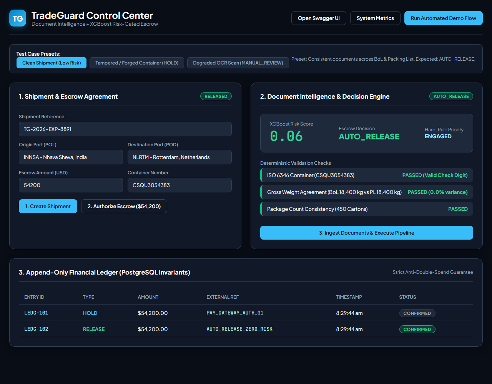
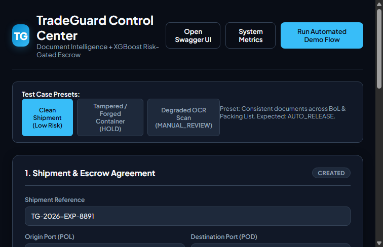
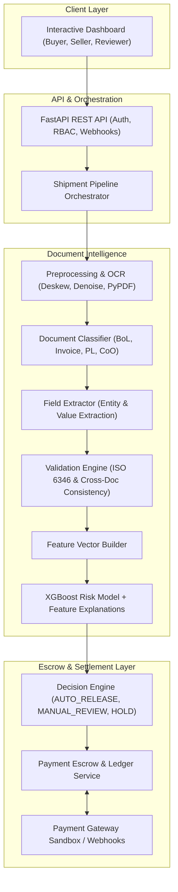

# TradeGuard

<div align="center">

### **Document Intelligence + Risk-Gated Payment Escrow for Maritime Trade**

[](https://www.python.org/downloads/)
[](https://fastapi.tiangolo.com)
[](https://xgboost.readthedocs.io/)
[](https://www.sqlalchemy.org/)
[](https://opensource.org/licenses/MIT)
[]()

<br/>



</div>

---

## 🌟 Executive Overview

In global maritime and container trade, discrepancies across trade documents (**Bill of Lading, Commercial Invoice, Packing List, Certificate of Origin**) cause customs holds, demurrage fees, and invoice fraud.

**TradeGuard** automates cross-border shipping document verification and pairs it with an **automated risk-gated payment escrow ledger**:
1. **Document Preprocessing & Ingestion**: Image deskewing, Otsu binarization, and noise filtering via OpenCV.
2. **Document Classification**: TF-IDF + Classifier to categorize shipping forms with calibrated confidence gates.
3. **Structured Field Extraction**: Domain regular expressions and anchor-based parsers extract container serials, weights, package counts, ports, dates, and valuations.
4. **Deterministic Multi-Document Reconciliation**:
   - **ISO 6346 Modulo-11 Container Check-Digit** mathematical validation.
   - Cross-checks gross weight variance between Bill of Lading and Packing List.
   - Reconciles carton counts and measures fuzzy string similarity for parties.
   - Verifies date precedence (Invoice Date $\le$ Shipped-on-Board Date).
5. **Machine Learning Risk Model**: Tabular feature vectors feed into an **XGBoost Risk Classifier** to estimate risk probability.
6. **Hard-Rule Priority Decision Engine**:
   - $\text{Risk} < 0.20 \rightarrow$ **`AUTO_RELEASE`** (immediate payout to seller).
   - $0.20 \le \text{Risk} < 0.60$ or low OCR confidence $\rightarrow$ **`MANUAL_REVIEW`** (routes to reviewer console).
   - $\text{Risk} \ge 0.60$ or **any hard rule failed** $\rightarrow$ **`HOLD`** (freeze escrow).
7. **Append-Only Escrow Ledger**: Enforces database-level double-spend prevention (`UNIQUE (payment_id) WHERE entry_type IN ('release', 'refund')`).

---

## 📸 Screenshots

| Control Center & Scenario Toolbar | Automated Pipeline & Ledger Confirmation |
|---|---|
|  |  |

---

## 📊 ML Evaluation Benchmark

Trained and evaluated on synthetic maritime shipment datasets with injected discrepancies:

| Metric | Score | Impact |
|---|---|---|
| **ROC-AUC** | **0.8584** | Robust discrimination across risk distributions |
| **Precision (Risky)** | **1.0000 (100%)** | Zero false alarms on auto-releases |
| **Clean Accuracy** | **1.0000 (100%)** | Clean trade shipments pass through with no friction |
| **Macro F1-Score** | **0.9202** | Balanced performance across classes |
| **Fail-Safe Gate** | **Deterministic Override** | Deterministic check failures (e.g. invalid container) override ML |

Full evaluation report available at [`docs/reports/eval_report.md`](tradeguard/docs/reports/eval_report.md).

---

## 🏗️ System Architecture



---

## 🚀 Quick Start & Installation

### 1. Prerequisites
- Python 3.11+
- Virtual environment (recommended)

### 2. Setup
```bash
git clone https://github.com/ppranjalsingh13/tradeguard.git
cd tradeguard
python -m venv .venv
source .venv/bin/activate  # On Windows: .venv\Scripts\activate
pip install -e ".[dev]"
```

### 3. Run the Test Suite
All 23 unit, validation, API, and stress tests:
```bash
python -m pytest tradeguard/tests -v
```

### 4. Run the Machine Learning Benchmark
```bash
# Windows PowerShell
$env:PYTHONPATH="tradeguard/src"; python -m tradeguard.ml.evaluate

# Linux / macOS
PYTHONPATH="tradeguard/src" python -m tradeguard.ml.evaluate
```

### 5. Launch the Live Server & Dashboard
```bash
# Windows PowerShell
$env:PYTHONPATH="tradeguard/src"; uvicorn tradeguard.api.app:app --reload --port 8000
```

- **Interactive Dashboard:** [http://localhost:8000/](http://localhost:8000/)
- **Swagger UI:** [http://localhost:8000/docs](http://localhost:8000/docs)
- **ReDoc:** [http://localhost:8000/redoc](http://localhost:8000/redoc)
- **System Metrics:** [http://localhost:8000/metrics](http://localhost:8000/metrics)

---

## 🧪 Testing Edge Cases & Stress Resilience

TradeGuard was evaluated against adversarial and unexpected inputs:
- **Empty / Non-printable input:** Filtered with confidence $\le 0.20$, routing to manual review.
- **Malformed Container Numbers:** Invalid letters or bad modulo-11 check digits trigger hard-rule holds.
- **Extreme Weight Outliers ($99.9\%$ variance):** Flagged with high-severity mismatch.
- **Double-Spend Prevention:** The ledger prevents secondary releases or refunds at the database layer.

---

## 📄 License
This project is open-source under the MIT License.
