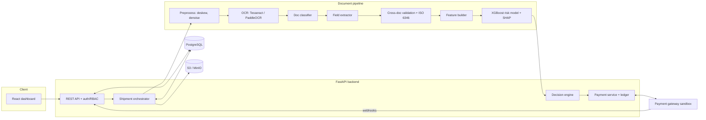
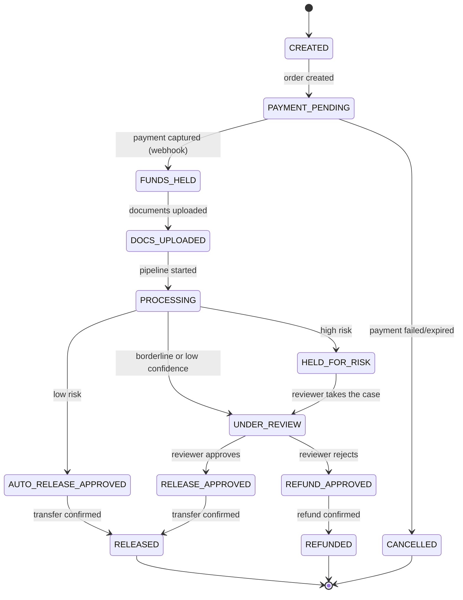

# 04. Architecture

## 1. System overview


## 2. Components
| Component | Responsibility |
|---|---|
| API layer | Auth, RBAC, request validation, OpenAPI docs, rate limiting |
| Orchestrator | Runs the processing pipeline per shipment, updates status, handles failures |
| Preprocess/OCR | Rasterize, clean images, extract text, word boxes, confidence |
| Classifier | Predicts document type and confidence |
| Extractor | Pulls structured fields per document type |
| Validation | Deterministic cross-document and domain checks |
| Feature builder | Turns validation outputs into the model's feature vector |
| Risk model | XGBoost probability of a problematic shipment, SHAP reasons |
| Decision engine | Combines score, hard rules and OCR confidence into a decision |
| Payment service | Creates orders, verifies payments, holds/releases/refunds, writes ledger |
| Review service | Reviewer queue and decisions |
| Model registry | Stores versions, metrics, and the active model per task |

## 3. Processing pipeline (per shipment)
1. Seller uploads documents; files stored in S3, rows created with status `uploaded`.
2. Orchestrator starts a background job when the shipment has the minimum document set.
3. Per document: preprocess, OCR, classify, extract fields.
4. Shipment-level: run validation checks, build features, score risk.
5. Decision engine applies thresholds and hard rules, writes the assessment.
6. Payment service acts on the decision: release, create review case, or keep held.
7. Every step writes status and an audit entry. Any exception leads to `MANUAL_REVIEW`, never to auto-release.

## 4. Decision logic
```
if pipeline_failed or ocr_conf < OCR_GATE or doc_type_conf < CLS_GATE:
    decision = MANUAL_REVIEW
elif any_high_severity_hard_rule_failed:
    decision = HOLD
elif score >= T_HIGH:
    decision = HOLD
elif score >= T_LOW:
    decision = MANUAL_REVIEW
else:
    decision = AUTO_RELEASE
```
`T_LOW` and `T_HIGH` come from validation-set cost analysis (releasing a bad shipment costs more than reviewing a good one) and are stored with each assessment.

## 5. Shipment state machine

Rule: money-moving states (`RELEASED`, `REFUNDED`) are entered only after the gateway confirms (or the sandbox ledger records) the action, and only once.

## 6. Key design decisions
| Decision | Rationale |
|---|---|
| Deterministic validation checks feed the ML model | Explainable features; the model adds weighting and interactions rather than replacing rules |
| Hard rules override ML | Some failures (invalid container check digit, duplicate BoL) should never be outvoted by a probability |
| Reject option on low OCR/classifier confidence | Avoids confident predictions on garbage input |
| Gateway behind an interface | Swap Razorpay/Stripe/ledger-only simulation without touching business logic |
| Append-only ledger | Money history is auditable and never edited |
| Async processing | Upload returns immediately; UI polls status |
| Stateless ML inference module | Same code serves the pipeline and the public `/classify` and `/extract` endpoints |

## 7. Security notes
- JWT access tokens with short lifetime; refresh tokens rotated.
- RBAC enforced in dependencies; ownership checks on every shipment/document access.
- Uploads: MIME sniffing, size limits, randomized storage keys, no execution of uploaded content; consider AV scanning as a stretch item.
- Webhooks: verify signature against the raw body; dedupe by event ID.
- Secrets via environment variables / AWS secrets; `.env.example` only in repo.
- Rate limiting on auth and upload routes.

## 8. Observability
Structured JSON logs with request and shipment IDs, per-stage timings, model version on every prediction, and a `/health` and `/metrics` endpoint (Prometheus format optional).
