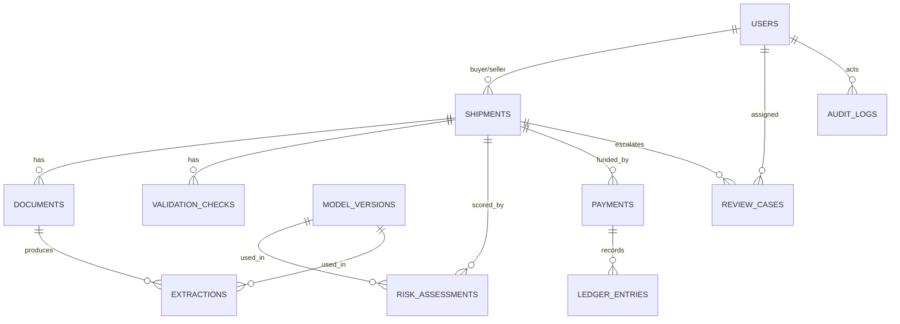

# 05. Database Schema (PostgreSQL)

## 1. Entity relationships


## 2. DDL (starting point)
```sql
CREATE TYPE user_role AS ENUM ('buyer','seller','reviewer','admin');
CREATE TYPE shipment_status AS ENUM (
  'created','payment_pending','funds_held','docs_uploaded','processing',
  'under_review','held_for_risk','release_approved','refund_approved',
  'released','refunded','cancelled'
);
CREATE TYPE doc_type AS ENUM ('bill_of_lading','commercial_invoice','packing_list','certificate_of_origin','other');
CREATE TYPE decision_type AS ENUM ('auto_release','manual_review','hold');
CREATE TYPE ledger_type AS ENUM ('hold','release','refund');

CREATE TABLE users (
  id UUID PRIMARY KEY DEFAULT gen_random_uuid(),
  email TEXT UNIQUE NOT NULL,
  password_hash TEXT NOT NULL,
  role user_role NOT NULL,
  created_at TIMESTAMPTZ NOT NULL DEFAULT now()
);

CREATE TABLE shipments (
  id UUID PRIMARY KEY DEFAULT gen_random_uuid(),
  reference TEXT UNIQUE NOT NULL,
  buyer_id UUID NOT NULL REFERENCES users(id),
  seller_id UUID NOT NULL REFERENCES users(id),
  origin_port TEXT, destination_port TEXT, incoterm TEXT,
  declared_amount_minor BIGINT NOT NULL CHECK (declared_amount_minor > 0),
  currency CHAR(3) NOT NULL DEFAULT 'INR',
  status shipment_status NOT NULL DEFAULT 'created',
  created_at TIMESTAMPTZ NOT NULL DEFAULT now(),
  updated_at TIMESTAMPTZ NOT NULL DEFAULT now()
);

CREATE TABLE model_versions (
  id UUID PRIMARY KEY DEFAULT gen_random_uuid(),
  task TEXT NOT NULL,              -- 'doc_classifier' | 'extractor' | 'risk'
  name TEXT NOT NULL, version TEXT NOT NULL,
  artifact_uri TEXT NOT NULL,
  metrics JSONB NOT NULL DEFAULT '{}',
  is_active BOOLEAN NOT NULL DEFAULT FALSE,
  created_at TIMESTAMPTZ NOT NULL DEFAULT now(),
  UNIQUE (task, version)
);

CREATE TABLE documents (
  id UUID PRIMARY KEY DEFAULT gen_random_uuid(),
  shipment_id UUID NOT NULL REFERENCES shipments(id) ON DELETE CASCADE,
  uploaded_by UUID NOT NULL REFERENCES users(id),
  storage_key TEXT NOT NULL,
  sha256 CHAR(64) NOT NULL,
  declared_type doc_type,
  predicted_type doc_type,
  type_confidence NUMERIC(5,4),
  ocr_mean_conf NUMERIC(5,4),
  page_count INT,
  status TEXT NOT NULL DEFAULT 'uploaded',   -- uploaded|processing|done|failed
  failure_reason TEXT,
  created_at TIMESTAMPTZ NOT NULL DEFAULT now()
);
CREATE INDEX ON documents (shipment_id);
CREATE INDEX ON documents (sha256);

CREATE TABLE extractions (
  id UUID PRIMARY KEY DEFAULT gen_random_uuid(),
  document_id UUID NOT NULL REFERENCES documents(id) ON DELETE CASCADE,
  model_version_id UUID REFERENCES model_versions(id),
  fields JSONB NOT NULL,
  field_confidences JSONB,
  created_at TIMESTAMPTZ NOT NULL DEFAULT now()
);

CREATE TABLE validation_checks (
  id UUID PRIMARY KEY DEFAULT gen_random_uuid(),
  shipment_id UUID NOT NULL REFERENCES shipments(id) ON DELETE CASCADE,
  check_name TEXT NOT NULL,
  passed BOOLEAN NOT NULL,
  severity TEXT NOT NULL,                    -- low|medium|high
  detail JSONB,
  created_at TIMESTAMPTZ NOT NULL DEFAULT now()
);

CREATE TABLE risk_assessments (
  id UUID PRIMARY KEY DEFAULT gen_random_uuid(),
  shipment_id UUID NOT NULL REFERENCES shipments(id) ON DELETE CASCADE,
  model_version_id UUID NOT NULL REFERENCES model_versions(id),
  score NUMERIC(5,4) NOT NULL,
  decision decision_type NOT NULL,
  features JSONB NOT NULL,
  top_reasons JSONB,
  thresholds JSONB NOT NULL,
  created_at TIMESTAMPTZ NOT NULL DEFAULT now()
);

CREATE TABLE payments (
  id UUID PRIMARY KEY DEFAULT gen_random_uuid(),
  shipment_id UUID NOT NULL REFERENCES shipments(id),
  gateway TEXT NOT NULL,
  gateway_order_id TEXT UNIQUE,
  gateway_payment_id TEXT UNIQUE,
  amount_minor BIGINT NOT NULL,
  currency CHAR(3) NOT NULL,
  status TEXT NOT NULL,                      -- created|captured|failed|refunded
  idempotency_key TEXT UNIQUE,
  created_at TIMESTAMPTZ NOT NULL DEFAULT now()
);

-- Append-only: never UPDATE or DELETE rows
CREATE TABLE ledger_entries (
  id BIGSERIAL PRIMARY KEY,
  shipment_id UUID NOT NULL REFERENCES shipments(id),
  payment_id UUID REFERENCES payments(id),
  entry_type ledger_type NOT NULL,
  amount_minor BIGINT NOT NULL,
  external_ref TEXT,
  created_at TIMESTAMPTZ NOT NULL DEFAULT now()
);
-- At most one release or refund per payment
CREATE UNIQUE INDEX one_terminal_entry_per_payment
  ON ledger_entries (payment_id) WHERE entry_type IN ('release','refund');

CREATE TABLE review_cases (
  id UUID PRIMARY KEY DEFAULT gen_random_uuid(),
  shipment_id UUID NOT NULL REFERENCES shipments(id),
  assigned_to UUID REFERENCES users(id),
  status TEXT NOT NULL DEFAULT 'open',       -- open|decided
  decision TEXT,                             -- approve|reject
  reason TEXT,
  decided_at TIMESTAMPTZ,
  created_at TIMESTAMPTZ NOT NULL DEFAULT now()
);

CREATE TABLE webhook_events (
  id BIGSERIAL PRIMARY KEY,
  gateway TEXT NOT NULL,
  event_id TEXT NOT NULL,
  event_type TEXT NOT NULL,
  payload JSONB NOT NULL,
  processed_at TIMESTAMPTZ,
  UNIQUE (gateway, event_id)
);

CREATE TABLE audit_logs (
  id BIGSERIAL PRIMARY KEY,
  actor_id UUID REFERENCES users(id),
  action TEXT NOT NULL,
  entity TEXT NOT NULL,
  entity_id TEXT NOT NULL,
  metadata JSONB,
  created_at TIMESTAMPTZ NOT NULL DEFAULT now()
);
```

## 3. Notes
- Money is stored in **minor units** (paise/cents) as integers. Never use floats for money.
- `ledger_entries` is append-only; the partial unique index makes a double release/refund impossible at the database level.
- `webhook_events` uniqueness gives idempotent webhook processing.
- `documents.sha256` lets you flag the same file reused across shipments.
- Use Alembic migrations; `gen_random_uuid()` needs the `pgcrypto` extension on older Postgres versions.
